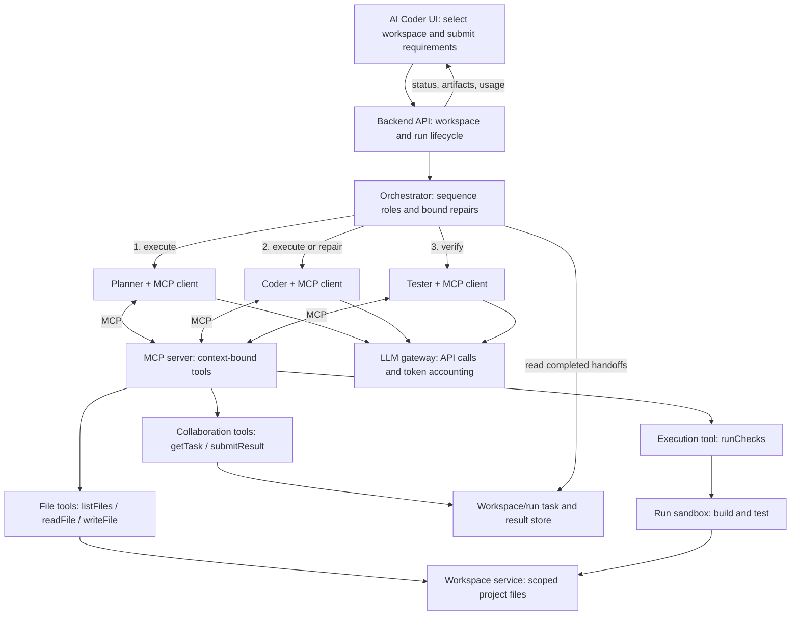

# AI Coder Architecture

[Back to README](../README.md)

This is an architecture scaffold. API routes, agent loops, MCP transport/tool
registration, persistence, and workspace execution are TODO. The modules define
boundaries and context models; they do not yet run a generation task.

## API, MCP, and internal services

- **HTTP API:** the frontend submits requirements and retrieves workspace/run status, events, files, downloads, and usage.
- **MCP tools:** agents fetch tasks, submit results, inspect/edit files, and run build/test checks.
- **Internal services:** the orchestrator schedules agents; the LLM gateway calls models and records usage; workspace/storage services enforce scope and persist state.

See [API and MCP Responsibilities](./interfaces.md) for the complete proposed endpoint/tool inventory and an end-to-end example. All entries remain TODO.

## MCP collaboration

The orchestrator schedules agents; MCP tools carry their task/result handoffs
and workspace actions. MCP does not schedule agents automatically. A later
agent reads an earlier agent's submitted result through the collaboration tools.
The server binds the authorized workspace/run context to a connection and
checks role access; passing IDs in tool arguments alone is not sufficient.

Proposed tool names are camelCase. Python methods use snake_case internally;
the MCP registration layer will map between them. No tool is registered yet.

## Multiple workspaces

- A workspace represents an independent user project. Each generation is a run
  within that workspace, identified by `(workspaceId, runId)`.
- Generated code, tasks, results, events, artifacts, and usage are scoped to that
  pair. See the proposed [runtime layout](../workspaces/README.md).
- Agents in the same run share its project directory. Different runs use
  separate project directories; restarting or continuing a prior run is TODO.
- Initially, serialize writes within a workspace. Separate workspaces can run
  independently once scheduling is implemented; concurrency is not implemented.
- File tools must reject paths escaping the run root, including symlink escapes.
  Build/test processes run in a sandbox mounted only with that run's project.
- The UI scopes run selections, caches, and subscriptions to the current workspace.
  Workspace switching must not display results from a previous workspace.

Workspace management, persistence, access validation, locks, and sandbox creation
are extension points in this scaffold, not implemented isolation guarantees.

## Module ownership

| Directory | Purpose | Team role |
| --- | --- | --- |
| `frontend/src/` | Workspace selection, requirements, progress, outputs, usage | Frontend |
| `backend/src/ai_coder/api/` | Workspace and run API boundaries | Backend |
| `backend/src/ai_coder/orchestration/` | Role sequencing and repair control | Backend |
| `backend/src/ai_coder/llm/` | Shared LLM calls and usage accounting | Backend |
| `backend/src/ai_coder/mcp/` | MCP client/server boundaries and tools | MCP & Tools |
| `backend/src/ai_coder/workspaces/` | Scoped paths and workspace lifecycle | MCP & Tools |
| `backend/src/ai_coder/storage/` | Workspace/run persistence interfaces | Backend |
| `backend/src/ai_coder/agents/` | Planner, Coder, and Tester implementations | Generation & Testing |
| `backend/tests/` | Planned integration and isolation checks | Shared |
| `workspaces/` | Ignored runtime output | Runtime |

## Next implementation decisions

1. Select the frontend/HTTP frameworks, MCP SDK/transport, and LLM provider.
2. Define API serialization and workspace/run status events with the frontend.
3. Implement workspace persistence and scoped tools; register a real MCP server.
4. Implement agent loops and one complete generation/test run with usage tracking.
