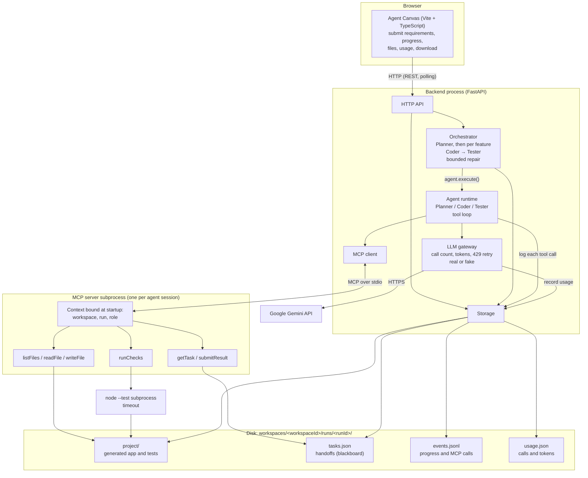

# AI Coder Architecture

[Back to README](../README.md)

This document records the agreed architecture. The frontend runs against MSW
mocks; backend API routes, agent loops, MCP tool registration, persistence, and
check execution are still to be implemented.

## Decisions

| Area | Decision |
| --- | --- |
| Collaboration pattern | Orchestrator-worker with a shared blackboard. The orchestrator sequences agents; agents hand off work through MCP `submitResult` / `getTask`, not by calling each other. |
| Runtime agents | Three: Planner, Coder, Tester. |
| Generated application | Plain HTML/CSS/JavaScript (`index.html`, `playlist.js`) with tests run by Node's built-in runner (`node --test`). No `npm install` in generated projects. |
| Backend framework | FastAPI (Python 3.11+), serving the contract in [interfaces.md](./interfaces.md) on port 8000. |
| MCP | Official `mcp` Python SDK (FastMCP), **stdio** transport. Each agent session starts its own MCP server subprocess. |
| LLM | Google Gemini via the `google-genai` SDK (AI Studio, free tier). Automatic function calling is disabled; the agent runtime runs its own tool loop so every model call is counted. |
| API keys | Each member uses their own AI Studio key (`GEMINI_API_KEY` in an uncommitted `.env`). The demo uses one key with its daily quota left unused beforehand. |
| Testing strategy | Black-box: the Tester writes tests from the requirements and the Planner's interface spec, without reading the implementation. Only the Coder changes code during repairs. |
| Feature-by-feature flow | The Planner splits the work into at most 4 features (`max_features`). Each feature goes Coder → Tester before the next starts; the Tester always runs every test, so earlier features keep being checked. |
| Repair limit | At most 3 repair rounds per run (`max_repairs`), shared by all features. A feature that cannot be repaired stops the run and the run reports the real test result. |
| Coordination | Assigning and monitoring work is ordinary code (the orchestrator), not an LLM agent: the flow is fixed, so code is predictable, testable, and costs no API calls. |
| Development mode | A fake LLM gateway returns fixed responses so the full pipeline can run without spending Gemini quota. |

## System overview

### Process boundaries

| Process | Count | Responsibility |
| --- | --- | --- |
| Frontend (browser) | 1 | User interface; talks to the backend over HTTP only. |
| Backend (FastAPI) | 1 | API, orchestration, agent runtime, LLM gateway, storage. |
| MCP server | 1 per agent session | Started by the agent's MCP client over stdio; exits when the agent finishes. |
| `node --test` | 1 per `runChecks` call | Runs the generated tests in the run's `project/` with a timeout. |

Only the MCP client ↔ MCP server link uses MCP. The frontend uses HTTP, the
backend's internal modules use ordinary Python calls, and the LLM gateway uses
HTTPS to Gemini. Running the MCP server as a separate stdio subprocess keeps the
MCP integration real rather than a direct in-process function call.

### Shared files on disk

The backend and MCP server are separate processes, so they exchange state
through the run directory (see the [runtime layout](../workspaces/README.md)).
Agents run one at a time, so a run's files have a single writer at any moment.

| File | Written by | Read by |
| --- | --- | --- |
| `project/` | MCP server (`writeFile`) | MCP server, backend (file preview and download) |
| `run.json` | Backend (orchestrator) | Backend (run APIs) |
| `tasks.json` | Backend (publishes tasks), MCP server (`submitResult`) | MCP server (`getTask`), backend |
| `checks.json` | MCP server (`runChecks`) | Backend (decides whether tests passed) |
| `events.jsonl` | Backend (orchestrator and agent runtime) | Backend (events API) |
| `usage.json` | Backend (LLM gateway) | Backend (run detail API) |

The JSON formats of these files are a shared contract between the backend and
MCP server owners; they are defined in the
[backend specification](./backend-spec.md#run-directory-files).

## One run, step by step

1. The UI submits a description and requirements; the API creates a run and
   starts the orchestrator in the background.
2. The orchestrator writes the Planner task to `tasks.json` and calls the
   Planner. The Planner submits a plan that names files, functions, inputs,
   and outputs precisely, plus an ordered list of features (at most 4).
3. For each feature, in order:
   1. The Coder reads the plan and the feature through `getTask`, adds the
      feature to the existing code through `writeFile`, and submits its result.
   2. The Tester reads the requirements, plan, and feature (not the
      implementation), adds a `*.test.js` file for the feature, calls
      `runChecks` (which runs all tests), and submits the real check result.
   3. If tests fail and the run's repair budget is not used up, the
      orchestrator sends the failure to the Coder and has the Tester run the
      unchanged tests again. Otherwise the run fails and later features never
      start.
4. When every feature has passed, the orchestrator marks the run completed. The
   UI reads events (including `Feature 2/4 started: …`), files, usage, and the
   download through the HTTP API.

### Agent tool loop

Each agent runs the same loop in the agent runtime:

1. Send the conversation to Gemini through the LLM gateway (call count +1,
   tokens recorded, including thinking tokens).
2. If Gemini requests tool calls, log each call to `events.jsonl`, forward it to
   the MCP client, and append the results to the conversation. Go back to step 1.
3. If Gemini requests no tool call, the agent is finished.

Because every tool call is logged as an event, the UI can show entries such as
`Coder → writeFile(index.html)`, making the MCP traffic visible in the demo.

## Security checks (MCP server)

The MCP server treats every agent argument as untrusted:

- Workspace, run, and role come from the server's startup arguments, never from
  tool arguments.
- Paths must stay inside the run's `project/` directory: absolute paths,
  traversal segments, and symlink escapes are rejected.
- Role permissions are enforced: only the Coder writes application files; the
  Tester writes test files only and cannot read application source.
- `runChecks` runs only the fixed `node --test` command, with a timeout and
  bounded output. No arbitrary shell command is exposed.

## Multiple workspaces

- A workspace represents an independent user project. Each generation is a run
  within that workspace, identified by `(workspaceId, runId)`.
- Generated code, tasks, results, events, artifacts, and usage are scoped to that
  pair.
- Different runs use separate project directories; restarting or continuing a
  prior run is out of scope for now.
- Runs within a workspace execute one at a time. Concurrent workspaces are not
  required for the demo.
- The UI scopes run selections, caches, and subscriptions to the current
  workspace. Workspace switching must not display results from a previous
  workspace.

## Module ownership

The team works as a relay: one stage at a time, in the order of the
[team responsibilities](./team-responsibilities.md).

| Directory | Purpose | Stage — owner |
| --- | --- | --- |
| `frontend/src/` | Canvas, workspaces, file preview, API client and mocks | 1 — Ching (done) |
| `frontend/src/` | Requirements submission, usage, MCP call events, download | 4 — Ching |
| `backend/src/ai_coder/main.py`, `models.py` | App composition and shared models | 2 — Pete |
| `backend/src/ai_coder/api/` | FastAPI routes for workspaces and runs | 2 — Pete |
| `backend/src/ai_coder/orchestration/` | Feature-by-feature sequencing and bounded repair | 2 — Pete |
| `backend/src/ai_coder/storage/` | Run directory files and ZIP packaging | 2 — Pete |
| `backend/src/ai_coder/mcp/` | MCP server, tools, client wrapper | 3 — Member A |
| `backend/src/ai_coder/workspaces/` | Scoped path resolution and role permissions | 3 — Member A |
| `backend/src/ai_coder/llm/` | Gemini gateway, usage accounting, fake LLM | 4 — Ching |
| `backend/src/ai_coder/agents/` | Tool loop and runnable agents | 4 — Ching |
| `backend/src/ai_coder/agents/` | Planner/Coder/Tester prompts tuned on Gemini | 5 — Member B |
| `backend/tests/` | Integration and isolation checks | 5 — Member B |
| `workspaces/` | Ignored runtime output | Runtime |

## Handoffs

Each stage defines the interfaces it owns, documents them, and hands them to the
next stage, which builds on them as written.

| From stage | Interface | Used by stage |
| --- | --- | --- |
| 1 — Ching | HTTP API — [interfaces.md](./interfaces.md) (done) | 2 |
| 2 — Pete | Run directory layout and JSON formats of `run.json`, `tasks.json`, `events.jsonl`, `usage.json` | 3, 4 |
| 2 — Pete | How the orchestrator calls an agent and how events and usage are recorded | 4 |
| 3 — Member A | Argument and result schemas of the six MCP tools, and the MCP client wrapper | 4 |
| 3 — Member A | Playlist Mixer requirements written as checkable rules | 5 |
| 4 — Ching | A complete pipeline running on the fake LLM, and how to switch to Gemini | 5 |
| 5 — Member B | The final system, test results, demo script, and recorded backup demo | All (presentation and demo) |

## Implementation order

1. **Ching (done):** frontend, HTTP contract, architecture scaffold.
2. **Pete:** FastAPI routes, storage, and the orchestrator with placeholder
   agents; document the run files and the agent interface.
3. **Member A:** MCP server and tools on top of those files; document the tool
   schemas; write the Playlist Mixer requirements.
4. **Ching:** LLM gateway with the fake LLM, the tool loop, and runnable agents;
   run one complete pipeline on the fake LLM; connect the frontend to the real
   backend.
5. **Member B:** tune the prompts on Gemini until the generated app passes its
   tests, verify the repair loop, add backend tests, and prepare the demo.

The presentation is shared: each member presents their own part.
