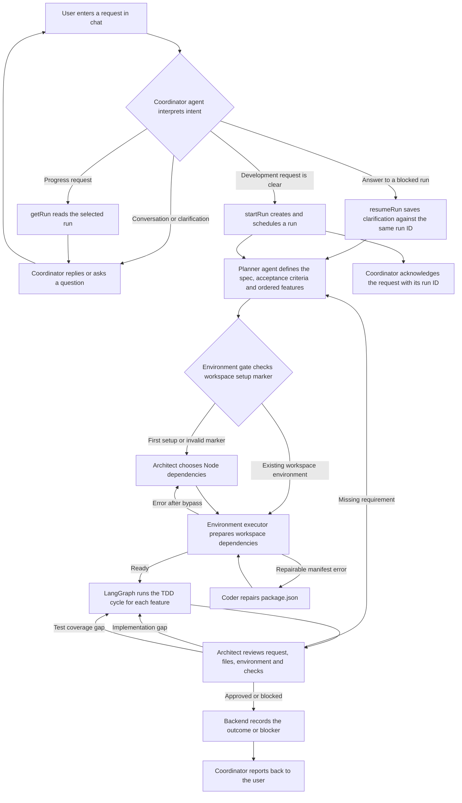
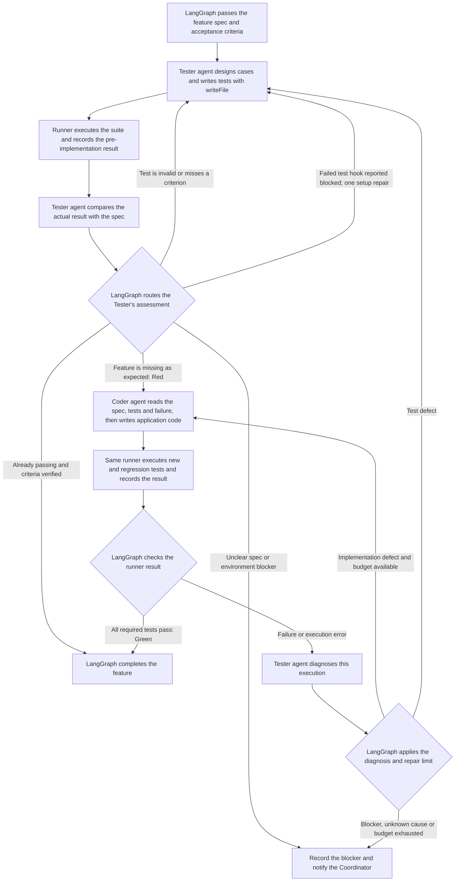

<!-- Author: Ching Kao; Student ID: 85768427 -->
# Coordinator and feature TDD workflow

Workspace chat invokes the LangChain Coordinator. The production backend schedules a LangGraph StateGraph for each development run. Planner, Architect, Tester, Coder and Coordinator share the same LLM gateway with the selected Gemini or Groq adapter.

## From chat to a run

The chat can clarify a request before a workspace is selected. Starting a run binds it to a workspace. If a run needs requirement clarification, the Coordinator attaches the user's answer to that run ID and the Planner revises the affected feature. Provider interruptions instead retain the input and name of the interrupted graph node in `run.json` (`continuation.resume_node`). Retrying that run, including after restarting the backend or selecting another model of the same provider, starts at that node without repeating planning, environment setup, or completed features. Older continuations without a node name retain the previous planning-based behavior. Node checkpoints preserve the prior execution and diagnosis; they do not preserve an in-flight agent's model conversation. A retry of a partially written authoring step must inspect and finish its existing files.

The deterministic environment gate asks Architect for a dependency plan only on the first setup or after a reused environment fails. A successful Architect setup writes `project/.ai-coder-environment.json`; later runs bypass the environment planning call. The executor still validates and prepares dependencies on every run, and installs again if the manifest or lockfile changes. It merges registry dependencies into `project/package.json`, runs npm with lifecycle scripts disabled, and keeps `node_modules` and its npm cache inside that workspace. The Node executable and operating system are still shared with the backend host. Runtime directories and internal markers are excluded from project file listings and download ZIPs; `package.json` and `package-lock.json` are included. Final Architect acceptance remains a separate gate before `completed`; a rejection routes to Planner, Coder, or Tester within the shared repair budget, or blocks the run with a reason.

If Node checks cannot resolve a bare npm package after bypass, the graph also consults Architect. Missing relative project files stay in the normal TDD diagnosis path.

After an environment repair during Red or Green, the graph repeats that same check rather than asking Tester to author tests again. Dependency declaration errors such as ETARGET, E404 and ERESOLVE can be sent to manifest repair. Host npm configuration failures, network errors and setup timeouts pause without spending the project's repair budget on unrelated package.json edits.

## One feature from Red to Green

Both runner nodes execute a fixed test command without an LLM. Each hands the next agent a recorded execution from the same run and feature. A failing assertion about required behavior can establish Red. A missing test runtime is an environment blocker. If a Red test hook fails and the Tester calls it blocked, the workflow gives the Tester one bounded chance to repair its setup before pausing. During implementation repairs the Coder changes application code and reruns the same tests. The Tester revises tests only when the diagnosis identifies a defect in the tests or the spec changes.

An absent project JavaScript module identified by the runner is routed deterministically to Coder when it matches the specified module paths (or no paths were specified). Red treats this as expected failure; Green treats it as an implementation defect. Imports outside the project, npm packages, test files, and paths conflicting with an explicitly specified module remain outside this shortcut. Other failures still use Tester diagnosis. Final Architect acceptance reads bounded project contents and recorded checks; passing counts alone do not establish requirement coverage.

When a test run reports SyntaxError, the executor performs `node --check` on project JavaScript files within a separate ten-second total limit, with the same project-only read boundary and minimal environment. A syntax failure in implementation goes to Coder; a syntax failure in a test goes to Tester. If syntax attribution is unavailable, the original failure is retained for diagnosis. This prevents a malformed imported application module from being mistaken for a broken test merely because the import failed before assertions.

## Running and verifying the workflow

Use Node.js 22.13+ for the runner. Install the backend dependencies, start both services with MSW disabled, select a workspace, and configure the selected provider in the chat panel. A small development request is “Implement a CommonJS module that exports add(a, b). It must add two integers.” Progress and the final Coordinator report appear in that conversation. A blocked run accepts clarification in the same chat.

Each run stores role handoffs in `tasks.json`, Node executions in `checks.json`, and routing decisions and Coordinator reports in `events.jsonl`. The runner executes the entire project suite at both checkpoints. A blocked run keeps the current feature and spec in `run.json` across backend restarts. An interrupted active run is marked failed on startup. Completed runs expose their project ZIP through the download API.

The graph gives workers only the MCP file tools needed for their phase. Planner and diagnosis do not receive file tools, Tester authors test files and may read tests plus `package.json`, and Coder writes implementation files. MCP enforces role-specific path permissions. Each agent invocation has a model-call, tool-call, and consecutive-tool-error limit in `agents/runtime.py`; graph repairs have a separate limit. LangGraph publishes tasks and records submissions through the existing storage service. Both test nodes call the same execution service as the MCP `runChecks` tool.

Run `backend/e2e/run.sh chat-run` for the Chrome walkthrough, or run `.venv/bin/python -m pytest tests/test_tdd_workflow.py` from `backend/` for the chat API, clarification/resume, repair and ZIP checks. Both tests substitute deterministic Gemini responses and execute the real graph, MCP processes, file writes and Node tests.
