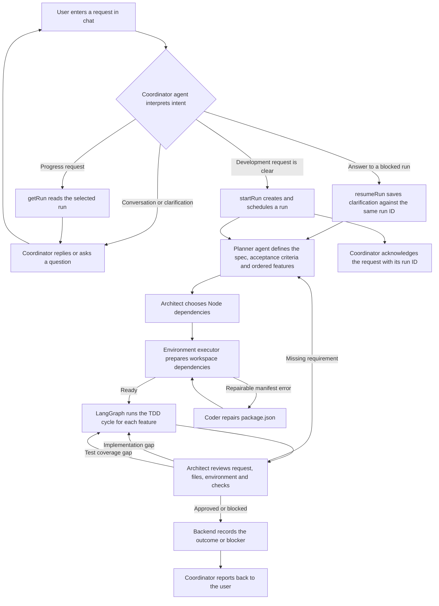
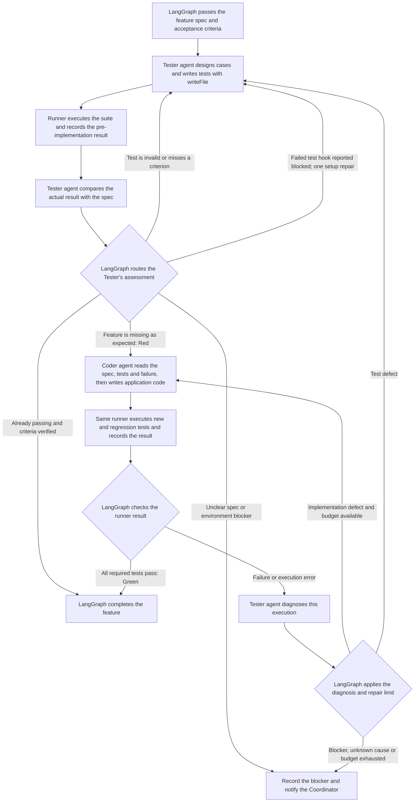

<!-- Author: Ching Kao; Student ID: 85768427 -->
# Coordinator and feature TDD workflow

Workspace chat invokes the LangChain Coordinator. The production backend schedules a LangGraph StateGraph for each development run. Planner, Architect, Tester, Coder and Coordinator share the same LLM gateway with the selected Gemini or Groq adapter.

## From chat to a run

The chat can clarify a request before a workspace is selected. Starting a run binds it to a workspace. If a run needs clarification, the Coordinator attaches the user's answer to that run ID. The Planner revises the spec and the graph resumes the affected feature.

The Architect returns a structured package list before tests begin. The environment executor merges registry dependencies into `project/package.json`, runs npm with lifecycle scripts disabled, and keeps `node_modules` and its npm cache inside that workspace. Installation runs again when the manifest or lockfile changes, including changes made by the Coder. The Node executable and operating system are still shared with the backend host. Installed dependencies and npm cache are excluded from project file listings and download ZIPs; `package.json` and `package-lock.json` are included. A final Architect review is required before `completed`; a rejection routes to Planner, Coder, or Tester within the shared repair budget, or blocks the run with a reason.

## One feature from Red to Green

Both runner nodes execute a fixed test command without an LLM. Each hands the next agent a recorded execution from the same run and feature. A failing assertion about required behavior can establish Red. A missing test runtime is an environment blocker. If a Red test hook fails and the Tester calls it blocked, the workflow gives the Tester one bounded chance to repair its setup before pausing. During implementation repairs the Coder changes application code and reruns the same tests. The Tester revises tests only when the diagnosis identifies a defect in the tests or the spec changes.

## Running and verifying the workflow

Use Node.js 22.13+ for the runner. Install the backend dependencies, start both services with MSW disabled, select a workspace, and configure the selected provider in the chat panel. A small development request is “Implement a CommonJS module that exports add(a, b). It must add two integers.” Progress and the final Coordinator report appear in that conversation. A blocked run accepts clarification in the same chat.

Each run stores role handoffs in `tasks.json`, Node executions in `checks.json`, and routing decisions and Coordinator reports in `events.jsonl`. The runner executes the entire project suite at both checkpoints. A blocked run keeps the current feature and spec in `run.json` across backend restarts. An interrupted active run is marked failed on startup. Completed runs expose their project ZIP through the download API.

The graph gives workers only the MCP file tools needed for their phase. Planner and diagnosis can list and read, Tester authors test files, and Coder writes implementation files. MCP enforces role-specific path permissions. LangGraph publishes tasks and records submissions through the existing storage service. Both test nodes call the same execution service as the MCP `runChecks` tool.

Run `backend/e2e/run.sh chat-run` for the Chrome walkthrough, or run `.venv/bin/python -m pytest tests/test_tdd_workflow.py` from `backend/` for the chat API, clarification/resume, repair and ZIP checks. Both tests substitute deterministic Gemini responses and execute the real graph, MCP processes, file writes and Node tests.
